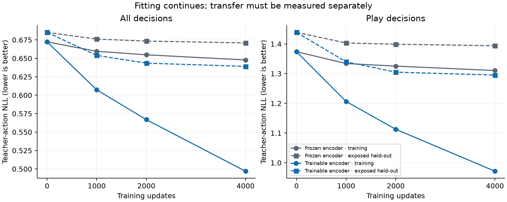

# Continued fitting and weakening transfer

The later corrected-policy run was still fitting its training data when it
stopped, but its late gains transferred weakly to held-out decisions. Between
updates 2,000 and 4,000, the trainable encoder's full-action training NLL fell
from **0.566865 to 0.496954**. On the already-exposed 128 held-out games it fell
from **0.643474 to 0.639106**. For play decisions, the late held-out NLL difference
is **−0.009960 [−0.023028, +0.003321]**, leaving that improvement unresolved.

This qualifies the [coverage and fitting diagnosis](even_steven_coverage_20260924.md):
the endpoint is not a convergence result, but more ordinary fitting is also not
established as a sufficient remedy. Learning the training examples and transferring
their interactions remain separate problems. These are trajectories of the later
Stage 2 corrected-policy run, not a reconstruction of the original pretraining
optimizer trajectory or a new autonomous win-rate measurement.

The [machine-readable report](data/fitting_trajectory_20260924.json) retains all
families, original coverage strata, intermediate predictions, optimizer windows,
case trajectories and paired comparisons. The [execution summary](../../eval/fitting_trajectory_20260924/summary_v1.json)
links their immutable input hashes.

## Complete trajectories

Both arms use the same 1,000 training games and 202,141 decisions, with the same
row order, unit full-action imitation loss and AdamW recipe. The learning rate
warms up for 100 updates and stays at 3e−5; it did not decay near the endpoint.
All 4,000 optimizer records in each arm have finite logged losses and gradients.
Every saved snapshot is included; no checkpoint is selected from these results.

| Updates | Frozen training NLL | Frozen held-out NLL | Trainable training NLL | Trainable held-out NLL |
| ---: | ---: | ---: | ---: | ---: |
| 0 | 0.672312 | 0.685193 | 0.672312 | 0.685193 |
| 1,000 | 0.659596 | 0.676136 | 0.607324 | 0.653995 |
| 2,000 | 0.654788 | 0.673418 | 0.566865 | 0.643474 |
| 4,000 | 0.647823 | 0.670901 | 0.496954 | 0.639106 |

The trainable arm's training agreement rises from 84.24% to 85.83% over the
last interval; held-out agreement rises from 82.58% to 82.72%. Its training
play agreement rises from 72.33% to 75.14%, while held-out play agreement moves
from 67.74% to 67.99%. Additional fitting therefore has a much larger measured
effect on these training decisions than on these held-out decisions. That
comparison does not quantify a causal share of the win gap.

| Trainable updates, later minus earlier | Held-out full-action NLL difference | Held-out play NLL difference |
| --- | ---: | ---: |
| 1,000 minus 0 | −0.031198 [−0.036250, −0.026277] | −0.099103 [−0.114949, −0.083893] |
| 2,000 minus 1,000 | −0.010522 [−0.013532, −0.007457] | −0.034663 [−0.043511, −0.025610] |
| 4,000 minus 2,000 | −0.004368 [−0.008385, −0.000076] | −0.009960 [−0.023028, +0.003321] |

Intervals are unadjusted 95% percentiles from 10,000 paired whole-game resamples,
using NumPy `default_rng(1729)`. Each draw resamples game loss sums and decision
counts together before taking their ratio. There are 128 game clusters, 26,045
decisions overall and 6,113 play decisions. The last overall interval only
narrowly excludes zero; the play interval includes zero. These are exploratory
comparisons on a reused panel, with one training replica, not fresh confirmation.

The matched trainable-minus-frozen NLL differences are also retained at every
snapshot. At 2,000 updates the overall difference is −0.029945
[−0.034449, −0.025385]; at 4,000 it is −0.031796 [−0.038712, −0.024599],
reproducing the prior endpoint result. No interaction test is used to claim that
the benefit of another training interval differs between arms.

## The diagnosed scoring choices

All three training examples previously selected by the same Even Steven / pair4
versus pair7 predicate are included. Each cell below is the trainable policy's
probability of the **complete recorded teacher action**, not conditional play
probability or probability summed over all actions using the same pair.

| Training seed / step | Update 0 | Update 1,000 | Update 2,000 | Update 4,000 | Selected pair ranks |
| --- | ---: | ---: | ---: | ---: | --- |
| 4000542 / 90 | 4.05% | 6.55% | 6.50% | 7.96% | 7 → 7 → 7 → 7 |
| 4000602 / 40 | 4.81% | 2.32% | 3.63% | 18.05% | 7 → 7 → 7 → 7 |
| 4000708 / 70 | 11.80% | 10.23% | 20.86% | 44.57% | 7 → 7 → 7 → 4 |

The first two rows were never correct at the four saved snapshots; this does
not rule out intervening changes. Their probabilities improve late, especially
the second case. The third becomes correct only at the endpoint. The frozen
encoder chooses pair7 in all twelve corresponding measurements. By update
4,000 these rows have received seven, six and seven presentations respectively.
Their earlier [same-state score replays](even_steven_coverage_20260924.md#actual-consequences-on-three-training-examples)
establish the score differences and their limits: the first two errors do not
immediately lose those training games, and one still clears the blind.

The ordinary-hand mixed-pair group contains 47 structural single-pair teacher
actions. Trainable pair-rank agreement across the four snapshots is **16, 14,
12, 13**. Its mean full-action NLL across all 176 mixed-pair states nevertheless
improves **2.3922 → 2.2393 → 2.1341 → 1.8812**. Aggregate likelihood improvement
does not guarantee improvement in this particular action-ranking measure.
Pair-pattern disagreements alone are not score or win losses.

The held-out fatal case, seed 850000015 step 28, remains pair7 at every snapshot
in both arms. The trainable policy's complete teacher-action probability is
**3.34% → 2.74% → 7.30% → 17.33%**. That rise does not cross the decision boundary:
the selected pair still scores 795 against an 800 requirement, whereas the
teacher's pair4 scores 1,989. On the broader held-out Even Steven group, NLL
improves through update 2,000 and then worsens from 1.6891 to 1.7100; exact
matches fall from 130 to 126 out of 227. These eighteen games do not establish
a statistically resolved subgroup regression.

## Verification and next experiment

The saved training snapshots are checked against their previous audited hashes,
complete row identities, presentation counts and family metrics. The initial
trajectory parser stopped before producing a result because compact hand-rank
lists omit unknown ranks and cannot serve as action-slot maps. The corrected
parser reconstructs every slot, including unknown ranks, from the pinned original
token cache. The failed attempt and correction are preserved.

Before measuring the four intermediate checkpoints, the inference worker
reproduces **all 26,045** saved trainable-endpoint predictions using the original
MPS device and batches of 32: every selected action and teacher NLL matches
exactly, with maximum NLL error zero. It then measures all four intermediate
checkpoints on that same cache. Archived source, checkpoint and input hashes
are unchanged; all imported project modules originate in the archived runtime.
The workers and analyzer actually exited zero and are terminal. No optimizer
or autonomous game was run in this audit.

A separate [verification](../../eval/fitting_trajectory_20260924/verification_v1.json)
recounts the raw predictions, all twenty declared NLL comparisons and the entire
endpoint control. Its bootstrap uses game-frequency matrices to independently
recompute the intervals; it is not a second neural forward. All checks pass.

The next controlled intervention should compare ordinary additional fitting
against a training-data or weighting change aimed at consequential scoring
choices, with matched compute and the current architecture. Ordinary additional
fitting must be a measured control: the growing training-to-held-out gap does
not justify assuming that further training accuracy will translate into wins.
Use broad, training-defined decision criteria rather than the identities of
these exposed errors, and assess unseen whole games and combinations. Such an
intervention had not been specified or launched at the end of this audit. The
subsequent [consequence-weighting preparation](consequence_weighting_preparation_20260924.md)
specifies a fixed rule and completes the training-cost replay and training
smoke; scientific fitting remains pending. Neither result establishes that
weighting will work.

The replicated fresh-win and consequential early-decision requirements remain
unmet. The failed Stage 3 attempt and its unopened fresh-outcome gate remain
untouched. World-model work stays deferred.
