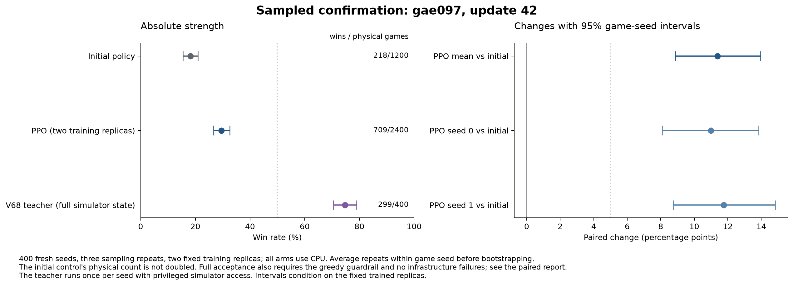
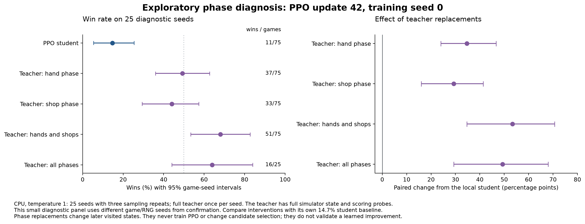

The selected outcome-only PPO recipe `gae097` at update 42 has a **validated improvement**. Its two replicas average 29.54% sampled wins on 400 confirmation seeds, versus 18.17% for the initial actor. The paired change is +11.38 [+8.87, +13.96] percentage points (95% interval).

| Mode | Initial actor | Selected PPO, two replicas | Paired change [95% CI], pp |
| --- | --- | --- | --- |
| sampled | 18.17% | 29.54% | +11.38 [+8.87, +13.96] |
| greedy | 34.50% | 46.38% | +11.88 [+7.25, +16.38] |

Both training replicas improve in sampled play.

Sampling repeats and fixed training replicas are averaged within each game seed before bootstrapping; the shared initial control is evaluated once. The physical denominators are 2,400 selected and 1,200 control sampled games, plus 800 selected and 400 control greedy games.

Frozen checkpoints: [training replica 0](../../eval/outcome_ppo_20260913/trials/gae097_seed0/leg_from30_to42/checkpoint.pt); [training replica 1](../../eval/outcome_ppo_20260913/trials/gae097_seed1/leg_from30_to42/checkpoint.pt); [initial actor control](../../eval/outcome_ppo_20260913/critic_seed0/checkpoint.pt). Their hashes and configuration are recorded in [the frozen selection](../../eval/outcome_ppo_20260913/candidate_selection.json). Training replica zero was fixed as the representative for follow-up probes before confirmation.

The selected model still loses most sampled games. This is an intermediate result, not evidence that the task is solved or that its current win rate is a ceiling.

The study has charged 11.160 of the 12 additional MPS hours. The ledger includes failed jobs and CPU work inside an exclusive accelerator job. Separate CPU diagnostics and evaluations do not consume that allowance. [Compute ledger](../../eval/outcome_ppo_20260913/compute.json).

Final confirmation is allocated to CPU for every arm. This releases MPS time for explicitly declared matched continuations while retaining five accelerator minutes for backend checks. The 12-hour cap and full confirmation panel remain fixed. [Prospective resource allocation](../../eval/outcome_ppo_20260913/resource_allocation_v2.json).

PPO uses ten points for an Ante-8 win and zero otherwise, with discount one. It receives no teacher labels, teacher action replacements, imitation loss, self-imitation, or strategic reward bonuses. Existing pretrained weights, candidates, risk inputs and automatic Joker ordering remain part of the reference interface. [Methods, decision history and limitations](outcome_ppo.md).

This investigation starts after the action-readout refactor. That earlier study's combined entity-sale and card-subset heads raised confirmed sampled wins from 3.58% to 19.33%, a paired gain of 15.75 points [13.54, 18.04], using existing observations and a frozen encoder. It used a different control and seed panel. The present PPO control is the already improved actor. [Earlier architecture confirmation](action_refactor_results.md).

Established mechanisms and the limits of the evidence:

| Finding | Evidence | What it establishes |
| --- | --- | --- |
| Original action readouts underused available information | [Architecture controls and confirmation](action_refactor.md) | The combined entity-sale and complete-subset correction produces a replicated gameplay gain with unchanged observations. The hand correction jointly changes probability restrictions, representation and training exposure; their individual contributions remain unresolved. |
| Completion-selected critic labels | [Exact rollout reconstruction](../../eval/outcome_ppo_20260913/labels_gae100_seed0_u20.json); [two-replica CPU control](../../eval/outcome_ppo_20260913/label_selection_cpu_control/manifest.json) | Winning initial states receive fewer labels. Holding representations and optimizer ordering fixed, this selection makes initial forecasts too pessimistic. The complete-critic bundle changes sampled wins by -0.42 [-3.67, +2.75] points and greedy wins by -4.25 [-8.25, -0.25] points in matched development play. The bundle does not isolate its individual components. |
| Critic calibration at transfer | [Complete student trajectories](../../eval/outcome_ppo_20260913/critic_seed0/manifest.json) | The original head forecasts about 83% wins against 16% observed on critic-validation games. Private-head fitting corrects calibration; both PPO pilots use it, so its gameplay effect is not isolated. |
| Return-loss objective mismatch | [Production Huber-loss probe](../../eval/outcome_ppo_20260913/return_loss_audit.json) | For binary 0/10 returns with 20% wins, the Huber optimum is .25 rather than the mean 2.0. Live residuals are smaller; this alone does not establish a large gameplay effect. |
| Remaining hand and shop errors | [Selected-policy phase interventions](../../eval/outcome_ppo_20260913/selected_phase_diagnostic/comparison.json) | On 25 diagnostic seeds, the selected replica wins 14.67%. Teacher hand, shop and combined replacements reach 49.33%, 44.00% and 68.00%. Both phases leave policy headroom. Teacher information and later state changes remain part of these interventions; these are not trained-policy gains. |
| Shared critic interference | [Frozen gradient audit](../../eval/outcome_ppo_20260913/gradient_audit_initial/result.json) | Weighted critic/actor backbone gradient ratio .145, cosine -.070 on the probe. This does not support a claim that the critic overwhelms the shared encoder. |
| Long-term credit | [Complete-game trace audit](../../eval/outcome_ppo_20260913/credit_audit.json) | Lambda .97 and 1 disagree in sign on 27.7% of decisions. Actual PPO bootstraps fragments; a realized outcome does not establish whether each preceding action was good. |
| Mixture is a reference distribution | [Production normalizer probe](../../eval/outcome_ppo_20260913/mixture_capacity_audit.json) | Learned hand scores reweight the mixture before final normalization. An action absent from candidates can rise from .1 to .9 probability at mixture .5. The distribution layer has no fixed .5 cap; learned representations and finite exploration remain separate questions. |
| Checkpoint and reservation defects | [Failing reservation regression](../../eval/outcome_ppo_20260913/reservation_before.log); [MPS hardware reproducer](../../eval/outcome_ppo_20260913/mps_rng_hardware/result.json) | Complete seed reservations and checkpoint configuration were fixed before this PPO study. The separate MPS RNG fix reproduces all 512 test draws exactly, versus 31 matches before. This establishes RNG persistence, with no claim of a win-rate gain. |

Development uses CPU, 200 game seeds, three sampling repeats and two training replicas. Intervals resample game seeds after averaging repeats and replicas. They condition on these two trained replicas and do not include variability from new training seeds. The initial control has 600 physical sampled games and is not counted twice.

| Recipe | Updates | Sampled wins | Sampled change [95% CI], pp | Greedy wins | Greedy change [95% CI], pp |
| --- | --- | --- | --- | --- | --- |
| [gae097_complete](../../eval/outcome_ppo_20260913/development_gae097_complete_u30_comparison.json) | 30 | 333/1200 (27.75%) | +10.25 [+6.92, +13.67] | 41.00% | +5.50 [-0.50, +11.50] |
| [gae097_lr3e5](../../eval/outcome_ppo_20260913/development_gae097_lr3e5_u30_comparison.json) | 30 | 345/1200 (28.75%) | +11.25 [+7.58, +14.92] | 41.75% | +6.25 [+0.00, +12.50] |
| [gae097_lr3e5](../../eval/outcome_ppo_20260913/development_gae097_lr3e5_u42_comparison.json) | 42 | 365/1200 (30.42%) | +12.92 [+9.25, +16.67] | 47.75% | +12.25 [+5.00, +19.50] |
| [gae097](../../eval/outcome_ppo_20260913/development_gae097_u20_comparison.json) | 20 | 301/1200 (25.08%) | +7.58 [+4.33, +10.83] | 40.75% | +5.25 [-0.75, +11.25] |
| [gae097](../../eval/outcome_ppo_20260913/development_gae097_u30_comparison.json) | 30 | 338/1200 (28.17%) | +10.67 [+7.25, +14.17] | 45.25% | +9.75 [+2.75, +16.75] |
| [gae097](../../eval/outcome_ppo_20260913/development_gae097_u42_comparison.json) | 42 | 372/1200 (31.00%) | +13.50 [+9.75, +17.33] | 43.25% | +7.75 [+1.25, +14.50] |
| [gae100](../../eval/outcome_ppo_20260913/development_gae100_u20_comparison.json) | 20 | 288/1200 (24.00%) | +6.50 [+3.25, +9.83] | 38.25% | +2.75 [-3.00, +8.75] |

The seed-zero lambda-one pilot alone has a two-update runtime-probe restart. Its initial GAE comparison is therefore not a pure trace-length intervention. Seed-one initial legs are uninterrupted. Later treatment arms share their replica's restart boundary. The original checkpoints omit MPS RNG state, so their stream restarts cannot be undone retroactively.

The direct replicated lambda-.97 versus lambda-one sampled difference is +1.08 [-1.67, +3.92] points. This does not establish a superior GAE setting. [Matched initial recipe comparison](../../eval/outcome_ppo_20260913/initial_gae_contrast.json).

Additional PPO is compared with the same recipe's earlier checkpoints on the same development games. Later checkpoints include the declared process restarts. These paired changes describe learning within the measured budget; they do not establish an asymptotic plateau.

| Recipe | Updates | Sampled change [95% CI], pp | Greedy change [95% CI], pp | Sampled changes by training seed, pp |
| --- | --- | --- | --- | --- |
| [gae097_lr3e5](../../eval/outcome_ppo_20260913/continuation_gae097_lr3e5_u30_to42.json) | 30 to 42 | +1.67 [-1.25, +4.58] | +6.00 [+0.75, +11.25] | 0: +1.67, 1: +1.67 |
| [gae097](../../eval/outcome_ppo_20260913/continuation_gae097_u20_to30.json) | 20 to 30 | +3.08 [+0.33, +5.83] | +4.50 [+0.00, +9.00] | 0: +5.17, 1: +1.00 |
| [gae097](../../eval/outcome_ppo_20260913/continuation_gae097_u30_to42.json) | 30 to 42 | +2.83 [-0.25, +6.00] | -2.00 [-6.75, +2.75] | 0: +5.33, 1: +0.33 |

The update-30 interventions are paired against equally trained `gae097` controls. These are development diagnostics.

| Intervention | Sampled change [95% CI], pp | Greedy change [95% CI], pp | Sampled changes by training seed, pp |
| --- | --- | --- | --- |
| gae097_complete | -0.42 [-3.67, +2.75] | -4.25 [-8.25, -0.25] | 0: -2.00, 1: +1.17 |
| gae097_lr3e5 | +0.58 [-2.33, +3.58] | -3.50 [-8.00, +1.00] | 0: -1.50, 1: +2.67 |

The update-42 interventions are paired against equally trained `gae097` controls. These are development diagnostics.

| Intervention | Sampled change [95% CI], pp | Greedy change [95% CI], pp | Sampled changes by training seed, pp |
| --- | --- | --- | --- |
| gae097_lr3e5 | -0.58 [-3.92, +2.67] | +4.50 [-1.00, +10.00] | 0: -5.17, 1: +4.00 |

Critic forecasts on student-played development games are descriptive. Each policy has its own realized outcomes; lower calibration error alone does not demonstrate better gameplay. The final column shows whether rollout outcome labels actually train the critic.

| Checkpoint | Initial win forecast | Observed sampled wins | Start Brier loss | Uses rollout outcome labels |
| --- | --- | --- | --- | --- |
| [gae097_complete_seed0_u30_dev200](../../eval/outcome_ppo_20260913/labels_gae097_complete_seed0_u30.json) | 22.64% | 27.00% | 0.1994 | False |
| [gae097_complete_seed1_u30_dev200](../../eval/outcome_ppo_20260913/labels_gae097_complete_seed1_u30.json) | 25.75% | 28.50% | 0.2027 | False |
| [gae097_lr3e5_seed0_u30_dev200](../../eval/outcome_ppo_20260913/labels_gae097_lr3e5_seed0_u30.json) | 13.78% | 27.50% | 0.2183 | True |
| [gae097_lr3e5_seed0_u42_dev200](../../eval/outcome_ppo_20260913/labels_gae097_lr3e5_seed0_u42.json) | 15.61% | 29.17% | 0.2258 | True |
| [gae097_lr3e5_seed1_u30_dev200](../../eval/outcome_ppo_20260913/labels_gae097_lr3e5_seed1_u30.json) | 10.40% | 30.00% | 0.2482 | True |
| [gae097_lr3e5_seed1_u42_dev200](../../eval/outcome_ppo_20260913/labels_gae097_lr3e5_seed1_u42.json) | 22.29% | 31.67% | 0.2262 | True |
| [gae097_seed0_u20_dev200](../../eval/outcome_ppo_20260913/labels_gae097_seed0_u20.json) | 9.18% | 23.83% | 0.2032 | True |
| [gae097_seed0_u30_dev200](../../eval/outcome_ppo_20260913/labels_gae097_seed0_u30.json) | 9.39% | 29.00% | 0.2443 | True |
| [gae097_seed0_u42_dev200](../../eval/outcome_ppo_20260913/labels_gae097_seed0_u42.json) | 14.10% | 34.33% | 0.2653 | True |
| [gae097_seed1_u20_dev200](../../eval/outcome_ppo_20260913/labels_gae097_seed1_u20.json) | 8.72% | 26.33% | 0.2250 | True |
| [gae097_seed1_u30_dev200](../../eval/outcome_ppo_20260913/labels_gae097_seed1_u30.json) | 8.93% | 27.33% | 0.2329 | True |
| [gae097_seed1_u42_dev200](../../eval/outcome_ppo_20260913/labels_gae097_seed1_u42.json) | 12.79% | 27.67% | 0.2222 | True |
| [gae100_seed0_u20_dev200](../../eval/outcome_ppo_20260913/labels_gae100_seed0_u20.json) | 9.14% | 24.50% | 0.2087 | True |
| [gae100_seed1_u20_dev200](../../eval/outcome_ppo_20260913/labels_gae100_seed1_u20.json) | 6.18% | 23.50% | 0.2094 | True |

Teacher phase replacements are a separate CPU diagnosis on 50 reserved seeds. They measure the actor before PPO and never supply PPO labels or select the candidate. Student and partial-replacement arms have three repeats; the full teacher is deterministic.

| Diagnostic arm | Wins/games | Win rate | Mean final ante |
| --- | --- | --- | --- |
| student | 26/150 | 17.33% | 4.947 |
| hand | 60/150 | 40.00% | 6.773 |
| shop | 54/150 | 36.00% | 6.327 |
| hand_shop | 104/150 | 69.33% | 8.200 |
| teacher_all | 31/50 | 62.00% | 8.040 |

A post-confirmation CPU diagnosis repeats phase replacements on the first 25 reserved diagnostic seeds using the preselected seed-zero PPO representative. It reuses three sampling repeats and the same per-game diagnostic RNG. Hand replacement covers CHOOSE_ACTION, including consumables or reordering in that phase; shop replacement covers SHOP, leaving packs with the student. These are exploratory effects on one trained replica, separate from the 400-seed confirmation. [Verified selected-policy phase comparisons](../../eval/outcome_ppo_20260913/selected_phase_diagnostic/comparison.json).

| Selected-policy diagnostic arm | Wins/games | Win rate | Change from student [95% CI], pp |
| --- | --- | --- | --- |
| student | 11/75 | 14.67% | Reference |
| hand | 37/75 | 49.33% | +34.67 [+24.00, +46.67] |
| shop | 33/75 | 44.00% | +29.33 [+16.00, +41.37] |
| hand_shop | 51/75 | 68.00% | +53.33 [+34.67, +70.67] |
| teacher_all | 16/25 | 64.00% | +49.33 [+29.33, +68.00] |

Every repeated full-teacher action and outcome matches the earlier diagnostic exactly. The earlier diagnostic predates four PPO training/resume source changes and retains its original reward configuration; its student is not treated as a before/after control here. All arms in the new phase comparison use the frozen PPO reference source. The teacher has privileged simulator access, and phase replacements change later visited states; these effects neither identify a missing input nor validate a trained intervention. No replacement actions enter PPO training or alter the frozen confirmation selection.

Independent confirmation uses CPU for every arm, batch 32 and four engine workers. All 400 seeds and all four modes are evaluated:

| Arm | Mode | Wins/games | Win rate | 95% seed interval | Mean final ante | Stalls | Censored |
| --- | --- | --- | --- | --- | --- | --- | --- |
| seed0 | sampled | 350/1200 | 29.17% | [25.92%, 32.58%] | 6.011 | 0 | 0 |
| seed0 | greedy | 182/400 | 45.50% | [40.50%, 50.25%] | 6.843 | 0 | 0 |
| seed1 | sampled | 359/1200 | 29.92% | [26.67%, 33.33%] | 5.923 | 0 | 0 |
| seed1 | greedy | 189/400 | 47.25% | [42.25%, 52.25%] | 6.822 | 0 | 0 |
| control | sampled | 218/1200 | 18.17% | [15.42%, 21.00%] | 5.263 | 0 | 0 |
| control | greedy | 138/400 | 34.50% | [30.00%, 39.25%] | 6.327 | 0 | 0 |

Final ante preserves the simulator's terminal convention: a win can advance the state to ante nine. Ante-clear rates are reported separately.

| Arm/mode | Clear 1 | Clear 2 | Clear 3 | Clear 4 | Clear 5 | Clear 6 | Clear 7 | Clear 8 |
| --- | --- | --- | --- | --- | --- | --- | --- | --- |
| seed0/sampled | 95.58% | 87.08% | 79.00% | 68.58% | 56.67% | 47.08% | 37.92% | 29.17% |
| seed0/greedy | 97.50% | 91.25% | 84.00% | 78.00% | 69.75% | 63.75% | 54.50% | 45.50% |
| seed1/sampled | 95.25% | 86.75% | 78.83% | 66.08% | 54.08% | 45.00% | 36.33% | 29.92% |
| seed1/greedy | 97.75% | 91.25% | 84.00% | 77.25% | 69.75% | 61.00% | 54.00% | 47.25% |
| control/sampled | 92.58% | 82.17% | 72.25% | 58.00% | 44.25% | 33.83% | 25.00% | 18.17% |
| control/greedy | 97.25% | 88.50% | 81.50% | 72.25% | 62.50% | 53.25% | 43.00% | 34.50% |

| Confirmation acceptance condition against initial actor | Passed |
| --- | --- |
| independent confirmation | True |
| sampled gain at least five points | True |
| sampled paired ci excludes zero | True |
| both replicates positive | True |
| greedy rules out five point regression | True |
| no infrastructure failures | True |

After candidate confirmation, the separately evaluated V68 teacher wins 299/400 games (74.75%, 95% seed interval [70.50%, 79.00%]) on the same 400 seeds. Its search/scaler settings come from the original dataset's generation metadata. The selected student's sampled difference from this teacher is -45.21 [-49.38, -40.88] percentage points. The teacher receives full simulator state and scoring probes; this measures a remaining policy gap without proving that student inputs are sufficient. These games supply no PPO labels and do not change candidate selection or acceptance. [Matched teacher benchmark](../../eval/outcome_ppo_20260913/teacher_confirmation400/comparison.json).

The selected replicas lose all six sampled attempts on 139 of 400 confirmation seeds. The teacher wins 79 of those seeds; at least one selected replica wins greedily on 40 of them. Six losses do not establish that a seed is impossible for the policy, and success in any of six attempts is not a per-game win rate. These post-confirmation counts describe remaining failures without changing selection or acceptance. [Seed-level failure profile](../../eval/outcome_ppo_20260913/confirmation_failure_profile.json).

| Number of selected sampled wins on a seed | 0 | 1 | 2 | 3 | 4 | 5 | 6 |
| --- | --- | --- | --- | --- | --- | --- | --- |
| Confirmation seeds | 139 | 82 | 53 | 43 | 40 | 26 | 17 |

| Selected policy mode | Lost games | Highest ante reached on losses (ante: count) |
| --- | --- | --- |
| sampled | 1691 | 1: 110, 2: 204, 3: 192, 4: 278, 5: 287, 6: 224, 7: 214, 8: 182 |
| greedy | 429 | 1: 19, 2: 51, 3: 58, 4: 51, 5: 63, 6: 59, 7: 65, 8: 63 |

The terminal ante localizes where the run ended, not the earlier decisions that caused failure. The teacher's privileged information and scoring probes remain a separate possible contributor.

Pilots use Blue Deck, White Stake, ante eight, v13 observations, FP32, mixture .5, temperature one, 32 environments and 256 steps per rollout (8,192 transitions). PPO makes two passes with logical batch 640 and physical batch 320, clip .1, entropy coefficient .001, and Adam LR 1e-5 unless explicitly testing 3e-5. The complete-episode treatment uses a zero return residual, freezes critic parameters during actor updates, and applies 30 private outcome-tower replay updates of 256 rows instead of the reference's masked PPO outcome updates plus four replay updates. This is a declared bundle of value definition, label source, gradient scope and replay exposure.

Physical training below counts only updates executed within each trial directory. Inherited parent updates are not charged again to branches. Complete episode rates during training are descriptive because the policy changes while collecting them.

| Trial | Executed updates | Collected transitions | Leg wall hours | Completed update intervals |
| --- | --- | --- | --- | --- |
| gae097_complete_seed0 | 10 | 81920 | 0.648 | 20-30 |
| gae097_complete_seed1 | 10 | 81920 | 0.662 | 20-30 |
| gae097_lr3e5_seed0 | 22 | 180224 | 1.331 | 20-30, 30-42 |
| gae097_lr3e5_seed1 | 22 | 180224 | 1.355 | 20-30, 30-42 |
| gae097_seed0 | 42 | 344064 | 2.299 | 0-20, 20-30, 30-42 |
| gae097_seed1 | 42 | 344064 | 2.406 | 0-20, 20-30, 30-42 |
| gae100_seed0 | 20 | 163840 | 1.233 | 0-2, 2-20 |
| gae100_seed1 | 20 | 163840 | 1.057 | 0-20 |

Recorded optimizer metrics cover every completed PPO update. The last two columns average the final ten updates in each trial directory. These distinguish learning-rate changes or skipped optimization from limited gameplay progress; they do not by themselves establish the best step size or a cause of failure.

| Trial | Logged updates | Actual LR values | Minimum minibatch fraction | KL rollbacks | Last-ten mean KL | Last-ten clip fraction |
| --- | --- | --- | --- | --- | --- | --- |
| gae097_complete_seed0 | 10 | 1e-05 | 1.000 | 0 | 0.00069 | 0.0217 |
| gae097_complete_seed1 | 10 | 1e-05 | 1.000 | 0 | 0.00062 | 0.0227 |
| gae097_lr3e5_seed0 | 22 | 3e-05 | 1.000 | 0 | 0.00355 | 0.0771 |
| gae097_lr3e5_seed1 | 22 | 3e-05 | 1.000 | 0 | 0.00289 | 0.0706 |
| gae097_seed0 | 42 | 1e-05 | 1.000 | 0 | 0.00059 | 0.0198 |
| gae097_seed1 | 42 | 1e-05 | 1.000 | 0 | 0.00051 | 0.0187 |
| gae100_seed0 | 20 | 1e-05 | 1.000 | 0 | 0.00052 | 0.0172 |
| gae100_seed1 | 20 | 1e-05 | 1.000 | 0 | 0.00053 | 0.0191 |

Regression tests cover deck propagation, strict configuration restoration, complete seed exclusion, pure-outcome rewards, legal policy paths, paired seed statistics, branch optimizer preservation, critic isolation, teacher-free PPO execution, confirmation freezing and source archives. The source archive cannot bypass active-study pinning: it is accepted only after a final audit of the still-pinned workspace, with unchanged compute and training artifacts. [Critic intervention tests](../../tests/test_complete_episode_critic.py); [confirmation regression](../../tests/test_outcome_confirmation.py); [source archive regression](../../tests/test_outcome_source_archive.py).

The selected checkpoint's CPU/MPS probe passes on 16 observations and a separate 16-game sampled smoke. The supplemental states cover play, discard and multi-Joker sales; supervised and PPO likelihoods are also compared. These bounded checks establish implementation agreement, not gameplay strength. [Backend probabilities, gradients and provenance](../../eval/outcome_ppo_20260913/subset_backend_verification.json).

The final study audit passes, including 40 preserved original artifacts, completed training trajectories, learning curves, source hashes and compute accounting. [Final artifact audit](../../eval/outcome_ppo_20260913/verification_final.json).

After all study evaluations finished, checkpoint and logging maintenance was integrated. The archived reference was then verified again with unchanged training artifacts and compute. Future training uses a new source identity; the old study's source checks remain strict. [Verification after maintenance](../../eval/outcome_ppo_20260913/verification_after_maintenance.json).

The post-maintenance checkpoint/resume/pipeline/archive regression suite and changed-file lint pass. The accompanying audit verifies learning curves, episode provenance and immutable artifacts. [Final check commands and logs](../../eval/outcome_ppo_20260913/final_checks/manifest.json).

A host Python upgrade after all study games broke the workspace virtualenv's system-path link, preventing two final-check commands from starting. The workspace link now targets the original immutable Python 3.12.7 interpreter; its build and every recorded package version match. Subsequent checks pass, with no additional MPS usage. [Preserved environment and repair provenance](../../eval/outcome_ppo_20260913/environment_link_repair.json).

A separate 8-game CPU check runs two diagnostic seeds in sampled and greedy modes under both current and archived source. Every gameplay and critic field matches exactly after excluding timing. This verifies the archive runs on this host and checks the maintenance on bounded trajectories; it does not establish full PPO-process resume determinism. [Archive runtime comparison](../../eval/outcome_ppo_20260913/archive_runtime_check/manifest.json).

The next training recommendation is to continue ordinary outcome-only PPO from both selected update-42 checkpoints, with Adam LR 1e-5, gamma 1, lambda .97 and the same architecture, observations, reward and batch settings. A concrete next block is 58 further updates per replica, reaching 100 total, with gameplay evaluations at updates 50, 60, 80 and 100. Freeze this schedule before starting, retain the update-42 checkpoints as controls, and reserve a new 400-seed confirmation panel checked against every training manifest. The current confirmation panel is now exposed and cannot serve as untouched evidence for another adaptively chosen improvement.

Use a new study directory and source identity for that continuation, preserving model and optimizer state while explicitly recording the unavoidable restart of environments, replay state and the legacy MPS sampling stream. Future checkpoints now preserve MPS RNG state. Keep teacher actions and labels out of PPO. A full pretraining restart has less support as the next use of compute: the action-head refactor already produced a validated gain with unchanged observations, and this outcome-only PPO study adds another replicated gain.

Do not promote the complete-critic bundle or LR 3e-5 as established improvements. The bundle corrects measured calibration but shows no sampled advantage over equally trained ordinary PPO and lowers development greedy wins. The larger LR produces larger KL and clipping fractions but no established sampled advantage at update 42. Every configured PPO minibatch ran, with no KL rollbacks or unexpected learning-rate reductions, so those mechanisms do not explain the remaining weak play.

The remaining gap is substantial: sampled PPO wins 29.54% against the matched teacher's 74.75%, and it loses all six sampled attempts on 139 of 400 seeds; the teacher wins 79 of those. Selected-policy phase replacements expose headroom in both hand and shop decisions. They are exploratory interventions with privileged teacher information and changed later states, so they do not isolate a single missing input or establish that v13 already contains everything needed. If longer PPO fails to improve, the next diagnosis should isolate hand/shop decisions, credit assignment and information use under matched states before proposing an observation migration.

The last ordinary continuation, from update 30 to 42, changes development sampled wins by +2.83 percentage points with a paired interval of [-0.25, +6.00]. That interval leaves the recent learning rate uncertain; these short pilots do not establish a 24% or 30% ceiling. Majority-winning sampled play remains unvalidated. This study ends after 11.160 of its 12 additional MPS hours, with no further training scheduled under the frozen confirmation result.

Uncertainty remains about learning beyond this update budget, variability across additional training seeds, the separate contributions inside the complete-critic treatment, and information available to the teacher that the student cannot observe. Two training replicas and one confirmation seed panel do not settle these questions. No new observation features are inserted into v13.

Recreate the numeric tables with `.venv/bin/python tools/render_outcome_report.py`. The strict evaluation and paired-report commands, frozen checkpoint hashes, immutable game rows, TensorBoard curves and exact reference source are retained under [eval/outcome_ppo_20260913](../../eval/outcome_ppo_20260913). The source archive contains compiled simulator artifacts as well as Python code; environment and replay resets across PPO legs remain explicit limitations to whole-process exact replay.

The committed [portable game rows](data/outcome_confirmation_games.jsonl) and [configuration, hashes and results](data/outcome_confirmation_manifest.json) also reproduce every confirmation and teacher statistic without the original checkpoints or full logs: `.venv/bin/python tools/export_outcome_confirmation.py --verify-only`. Each physical initial-control and teacher game appears once.

Standalone PNG and SVG figures use `.venv/bin/python tools/plot_outcome_study.py --kind diagnostics`, `--kind confirmation` or `--kind selected_phases`. Runtime and plotting package versions are recorded in [environment.json](../../eval/outcome_ppo_20260913/environment.json) and [plotting_environment.json](../../eval/outcome_ppo_20260913/plotting_environment.json).
