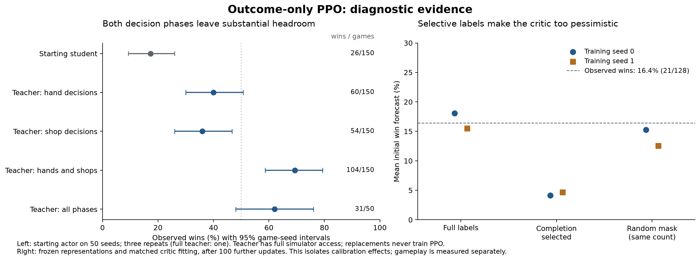

**Study in progress. No candidate has completed independent confirmation.** The tables below contain completed measurements only; development gains are exploratory.

The study has charged 11.160 of the 12 additional MPS hours. The ledger includes failed jobs and CPU work inside an exclusive accelerator job. Separate CPU diagnostics and evaluations do not consume that allowance. [Compute ledger](../../eval/outcome_ppo_20260913/compute.json).

Final confirmation is allocated to CPU for every arm. This releases MPS time for explicitly declared matched continuations while retaining five accelerator minutes for backend checks. The 12-hour cap and full confirmation panel remain fixed. [Prospective resource allocation](../../eval/outcome_ppo_20260913/resource_allocation_v2.json).

PPO uses ten points for an Ante-8 win and zero otherwise, with discount one. It receives no teacher labels, teacher action replacements, imitation loss, self-imitation, or strategic reward bonuses. Existing pretrained weights, candidates, risk inputs and automatic Joker ordering remain part of the reference interface. [Methods, decision history and limitations](outcome_ppo.md).

This investigation starts after the action-readout refactor. That earlier study's combined entity-sale and card-subset heads raised confirmed sampled wins from 3.58% to 19.33%, a paired gain of 15.75 points [13.54, 18.04], using existing observations and a frozen encoder. It used a different control and seed panel. The present PPO control is the already improved actor. [Earlier architecture confirmation](action_refactor_results.md).

Established mechanisms and the limits of the evidence:

| Finding | Evidence | What it establishes |
| --- | --- | --- |
| Original action readouts underused available information | [Architecture controls and confirmation](action_refactor.md) | The combined entity-sale and complete-subset correction produces a replicated gameplay gain with unchanged observations. The hand correction jointly changes probability restrictions, representation and training exposure; their individual contributions remain unresolved. |
| Completion-selected critic labels | [Exact rollout reconstruction](../../eval/outcome_ppo_20260913/labels_gae100_seed0_u20.json); [two-replica CPU control](../../eval/outcome_ppo_20260913/label_selection_cpu_control/manifest.json) | Winning initial states receive fewer labels. Holding representations and optimizer ordering fixed, this selection makes initial forecasts too pessimistic. The complete-critic bundle changes sampled wins by -0.42 [-3.67, +2.75] points and greedy wins by -4.25 [-8.25, -0.25] points in matched development play. The bundle does not isolate its individual components. |
| Critic calibration at transfer | [Complete student trajectories](../../eval/outcome_ppo_20260913/critic_seed0/manifest.json) | The original head forecasts about 83% wins against 16% observed on critic-validation games. Private-head fitting corrects calibration; both PPO pilots use it, so its gameplay effect is not isolated. |
| Return-loss objective mismatch | [Production Huber-loss probe](../../eval/outcome_ppo_20260913/return_loss_audit.json) | For binary 0/10 returns with 20% wins, the Huber optimum is .25 rather than the mean 2.0. Live residuals are smaller; this alone does not establish a large gameplay effect. |
| Remaining hand and shop errors | [Matched phase interventions](../../eval/outcome_ppo_20260913/phase_oracle_cpu/results.json) | With the starting actor, replacing either phase helps; replacing both reaches 69.3% on 50 diagnostic seeds. The teacher has full simulator access, so this does not prove current student inputs are sufficient. |
| Shared critic interference | [Frozen gradient audit](../../eval/outcome_ppo_20260913/gradient_audit_initial/result.json) | Weighted critic/actor backbone gradient ratio .145, cosine -.070 on the probe. This does not support a claim that the critic overwhelms the shared encoder. |
| Long-term credit | [Complete-game trace audit](../../eval/outcome_ppo_20260913/credit_audit.json) | Lambda .97 and 1 disagree in sign on 27.7% of decisions. Actual PPO bootstraps fragments; a realized outcome does not establish whether each preceding action was good. |
| Mixture is a reference distribution | [Production normalizer probe](../../eval/outcome_ppo_20260913/mixture_capacity_audit.json) | Learned hand scores reweight the mixture before final normalization. An action absent from candidates can rise from .1 to .9 probability at mixture .5. The distribution layer has no fixed .5 cap; learned representations and finite exploration remain separate questions. |
| Checkpoint and reservation defects | [Failing reservation regression](../../eval/outcome_ppo_20260913/reservation_before.log); [MPS hardware reproducer](../../eval/outcome_ppo_20260913/mps_rng_hardware/result.json) | Complete seed reservations and checkpoint configuration were fixed before this PPO study. The separate MPS RNG fix reproduces all 512 test draws exactly, versus 31 matches before. This establishes RNG persistence, with no claim of a win-rate gain. |

Development uses CPU, 200 game seeds, three sampling repeats and two training replicas. Intervals resample game seeds after averaging repeats and replicas. They condition on these two trained replicas and do not include variability from new training seeds. The initial control has 600 physical sampled games and is not counted twice.

| Recipe | Updates | Sampled wins | Sampled change [95% CI], pp | Greedy wins | Greedy change [95% CI], pp |
| --- | --- | --- | --- | --- | --- |
| [gae097_complete](../../eval/outcome_ppo_20260913/development_gae097_complete_u30_comparison.json) | 30 | 333/1200 (27.75%) | +10.25 [+6.92, +13.67] | 41.00% | +5.50 [-0.50, +11.50] |
| [gae097_lr3e5](../../eval/outcome_ppo_20260913/development_gae097_lr3e5_u30_comparison.json) | 30 | 345/1200 (28.75%) | +11.25 [+7.58, +14.92] | 41.75% | +6.25 [+0.00, +12.50] |
| [gae097_lr3e5](../../eval/outcome_ppo_20260913/development_gae097_lr3e5_u42_comparison.json) | 42 | 365/1200 (30.42%) | +12.92 [+9.25, +16.67] | 47.75% | +12.25 [+5.00, +19.50] |
| [gae097](../../eval/outcome_ppo_20260913/development_gae097_u20_comparison.json) | 20 | 301/1200 (25.08%) | +7.58 [+4.33, +10.83] | 40.75% | +5.25 [-0.75, +11.25] |
| [gae097](../../eval/outcome_ppo_20260913/development_gae097_u30_comparison.json) | 30 | 338/1200 (28.17%) | +10.67 [+7.25, +14.17] | 45.25% | +9.75 [+2.75, +16.75] |
| [gae097](../../eval/outcome_ppo_20260913/development_gae097_u42_comparison.json) | 42 | 372/1200 (31.00%) | +13.50 [+9.75, +17.33] | 43.25% | +7.75 [+1.25, +14.50] |
| [gae100](../../eval/outcome_ppo_20260913/development_gae100_u20_comparison.json) | 20 | 288/1200 (24.00%) | +6.50 [+3.25, +9.83] | 38.25% | +2.75 [-3.00, +8.75] |

The seed-zero lambda-one pilot alone has a two-update runtime-probe restart. Its initial GAE comparison is therefore not a pure trace-length intervention. Seed-one initial legs are uninterrupted. Later treatment arms share their replica's restart boundary. The original checkpoints omit MPS RNG state, so their stream restarts cannot be undone retroactively.

The direct replicated lambda-.97 versus lambda-one sampled difference is +1.08 [-1.67, +3.92] points. This does not establish a superior GAE setting. [Matched initial recipe comparison](../../eval/outcome_ppo_20260913/initial_gae_contrast.json).

Additional PPO is compared with the same recipe's earlier checkpoints on the same development games. Later checkpoints include the declared process restarts. These paired changes describe learning within the measured budget; they do not establish an asymptotic plateau.

| Recipe | Updates | Sampled change [95% CI], pp | Greedy change [95% CI], pp | Sampled changes by training seed, pp |
| --- | --- | --- | --- | --- |
| [gae097_lr3e5](../../eval/outcome_ppo_20260913/continuation_gae097_lr3e5_u30_to42.json) | 30 to 42 | +1.67 [-1.25, +4.58] | +6.00 [+0.75, +11.25] | 0: +1.67, 1: +1.67 |
| [gae097](../../eval/outcome_ppo_20260913/continuation_gae097_u20_to30.json) | 20 to 30 | +3.08 [+0.33, +5.83] | +4.50 [+0.00, +9.00] | 0: +5.17, 1: +1.00 |
| [gae097](../../eval/outcome_ppo_20260913/continuation_gae097_u30_to42.json) | 30 to 42 | +2.83 [-0.25, +6.00] | -2.00 [-6.75, +2.75] | 0: +5.33, 1: +0.33 |

The update-30 interventions are paired against equally trained `gae097` controls. These are development diagnostics.

| Intervention | Sampled change [95% CI], pp | Greedy change [95% CI], pp | Sampled changes by training seed, pp |
| --- | --- | --- | --- |
| gae097_complete | -0.42 [-3.67, +2.75] | -4.25 [-8.25, -0.25] | 0: -2.00, 1: +1.17 |
| gae097_lr3e5 | +0.58 [-2.33, +3.58] | -3.50 [-8.00, +1.00] | 0: -1.50, 1: +2.67 |

The update-42 interventions are paired against equally trained `gae097` controls. These are development diagnostics.

| Intervention | Sampled change [95% CI], pp | Greedy change [95% CI], pp | Sampled changes by training seed, pp |
| --- | --- | --- | --- |
| gae097_lr3e5 | -0.58 [-3.92, +2.67] | +4.50 [-1.00, +10.00] | 0: -5.17, 1: +4.00 |

Critic forecasts on student-played development games are descriptive. Each policy has its own realized outcomes; lower calibration error alone does not demonstrate better gameplay. The final column shows whether rollout outcome labels actually train the critic.

| Checkpoint | Initial win forecast | Observed sampled wins | Start Brier loss | Uses rollout outcome labels |
| --- | --- | --- | --- | --- |
| [gae097_complete_seed0_u30_dev200](../../eval/outcome_ppo_20260913/labels_gae097_complete_seed0_u30.json) | 22.64% | 27.00% | 0.1994 | False |
| [gae097_complete_seed1_u30_dev200](../../eval/outcome_ppo_20260913/labels_gae097_complete_seed1_u30.json) | 25.75% | 28.50% | 0.2027 | False |
| [gae097_lr3e5_seed0_u30_dev200](../../eval/outcome_ppo_20260913/labels_gae097_lr3e5_seed0_u30.json) | 13.78% | 27.50% | 0.2183 | True |
| [gae097_lr3e5_seed0_u42_dev200](../../eval/outcome_ppo_20260913/labels_gae097_lr3e5_seed0_u42.json) | 15.61% | 29.17% | 0.2258 | True |
| [gae097_lr3e5_seed1_u30_dev200](../../eval/outcome_ppo_20260913/labels_gae097_lr3e5_seed1_u30.json) | 10.40% | 30.00% | 0.2482 | True |
| [gae097_lr3e5_seed1_u42_dev200](../../eval/outcome_ppo_20260913/labels_gae097_lr3e5_seed1_u42.json) | 22.29% | 31.67% | 0.2262 | True |
| [gae097_seed0_u20_dev200](../../eval/outcome_ppo_20260913/labels_gae097_seed0_u20.json) | 9.18% | 23.83% | 0.2032 | True |
| [gae097_seed0_u30_dev200](../../eval/outcome_ppo_20260913/labels_gae097_seed0_u30.json) | 9.39% | 29.00% | 0.2443 | True |
| [gae097_seed0_u42_dev200](../../eval/outcome_ppo_20260913/labels_gae097_seed0_u42.json) | 14.10% | 34.33% | 0.2653 | True |
| [gae097_seed1_u20_dev200](../../eval/outcome_ppo_20260913/labels_gae097_seed1_u20.json) | 8.72% | 26.33% | 0.2250 | True |
| [gae097_seed1_u30_dev200](../../eval/outcome_ppo_20260913/labels_gae097_seed1_u30.json) | 8.93% | 27.33% | 0.2329 | True |
| [gae097_seed1_u42_dev200](../../eval/outcome_ppo_20260913/labels_gae097_seed1_u42.json) | 12.79% | 27.67% | 0.2222 | True |
| [gae100_seed0_u20_dev200](../../eval/outcome_ppo_20260913/labels_gae100_seed0_u20.json) | 9.14% | 24.50% | 0.2087 | True |
| [gae100_seed1_u20_dev200](../../eval/outcome_ppo_20260913/labels_gae100_seed1_u20.json) | 6.18% | 23.50% | 0.2094 | True |

Teacher phase replacements are a separate CPU diagnosis on 50 reserved seeds. They measure the actor before PPO and never supply PPO labels or select the candidate. Student and partial-replacement arms have three repeats; the full teacher is deterministic.

| Diagnostic arm | Wins/games | Win rate | Mean final ante |
| --- | --- | --- | --- |
| student | 26/150 | 17.33% | 4.947 |
| hand | 60/150 | 40.00% | 6.773 |
| shop | 54/150 | 36.00% | 6.327 |
| hand_shop | 104/150 | 69.33% | 8.200 |
| teacher_all | 31/50 | 62.00% | 8.040 |

Pilots use Blue Deck, White Stake, ante eight, v13 observations, FP32, mixture .5, temperature one, 32 environments and 256 steps per rollout (8,192 transitions). PPO makes two passes with logical batch 640 and physical batch 320, clip .1, entropy coefficient .001, and Adam LR 1e-5 unless explicitly testing 3e-5. The complete-episode treatment uses a zero return residual, freezes critic parameters during actor updates, and applies 30 private outcome-tower replay updates of 256 rows instead of the reference's masked PPO outcome updates plus four replay updates. This is a declared bundle of value definition, label source, gradient scope and replay exposure.

Physical training below counts only updates executed within each trial directory. Inherited parent updates are not charged again to branches. Complete episode rates during training are descriptive because the policy changes while collecting them.

| Trial | Executed updates | Collected transitions | Leg wall hours | Completed update intervals |
| --- | --- | --- | --- | --- |
| gae097_complete_seed0 | 10 | 81920 | 0.648 | 20-30 |
| gae097_complete_seed1 | 10 | 81920 | 0.662 | 20-30 |
| gae097_lr3e5_seed0 | 22 | 180224 | 1.331 | 20-30, 30-42 |
| gae097_lr3e5_seed1 | 22 | 180224 | 1.355 | 20-30, 30-42 |
| gae097_seed0 | 42 | 344064 | 2.299 | 0-20, 20-30, 30-42 |
| gae097_seed1 | 42 | 344064 | 2.406 | 0-20, 20-30, 30-42 |
| gae100_seed0 | 20 | 163840 | 1.233 | 0-2, 2-20 |
| gae100_seed1 | 20 | 163840 | 1.057 | 0-20 |

Regression tests cover deck propagation, strict configuration restoration, complete seed exclusion, pure-outcome rewards, legal policy paths, paired seed statistics, branch optimizer preservation, critic isolation, teacher-free PPO execution, confirmation freezing and source archives. The source archive cannot bypass active-study pinning: it is accepted only after a final audit of the still-pinned workspace, with unchanged compute and training artifacts. [Critic intervention tests](../../tests/test_complete_episode_critic.py); [confirmation regression](../../tests/test_outcome_confirmation.py); [source archive regression](../../tests/test_outcome_source_archive.py).

The selected checkpoint's CPU/MPS probe passes on 16 observations and a separate 16-game sampled smoke. The supplemental states cover play, discard and multi-Joker sales; supervised and PPO likelihoods are also compared. These bounded checks establish implementation agreement, not gameplay strength. [Backend probabilities, gradients and provenance](../../eval/outcome_ppo_20260913/subset_backend_verification.json).

Uncertainty remains about learning beyond this update budget, variability across additional training seeds, the separate contributions inside the complete-critic treatment, and information available to the teacher that the student cannot observe. Two training replicas and one confirmation seed panel do not settle these questions. No new observation features are inserted into v13.

Recreate the numeric tables with `.venv/bin/python tools/render_outcome_report.py`. The strict evaluation and paired-report commands, frozen checkpoint hashes, immutable game rows, TensorBoard curves and exact reference source are retained under [eval/outcome_ppo_20260913](../../eval/outcome_ppo_20260913). The source archive contains compiled simulator artifacts as well as Python code; environment and replay resets across PPO legs remain explicit limitations to whole-process exact replay.

Standalone PNG and SVG figures use `.venv/bin/python tools/plot_outcome_study.py --kind diagnostics` or `--kind confirmation`. Runtime and plotting package versions are recorded in [environment.json](../../eval/outcome_ppo_20260913/environment.json) and [plotting_environment.json](../../eval/outcome_ppo_20260913/plotting_environment.json).
